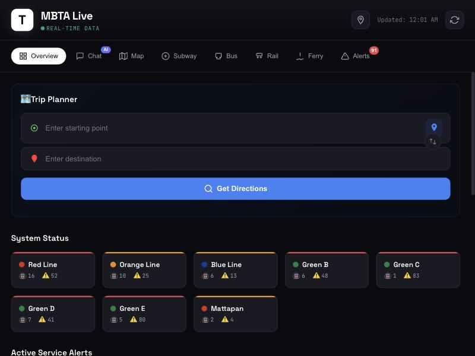
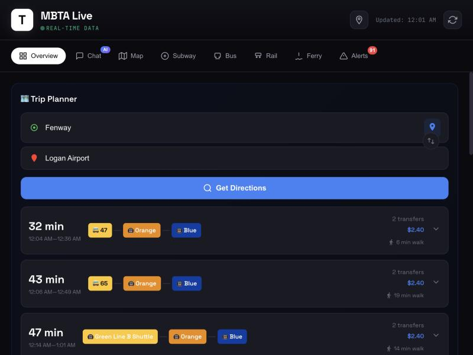
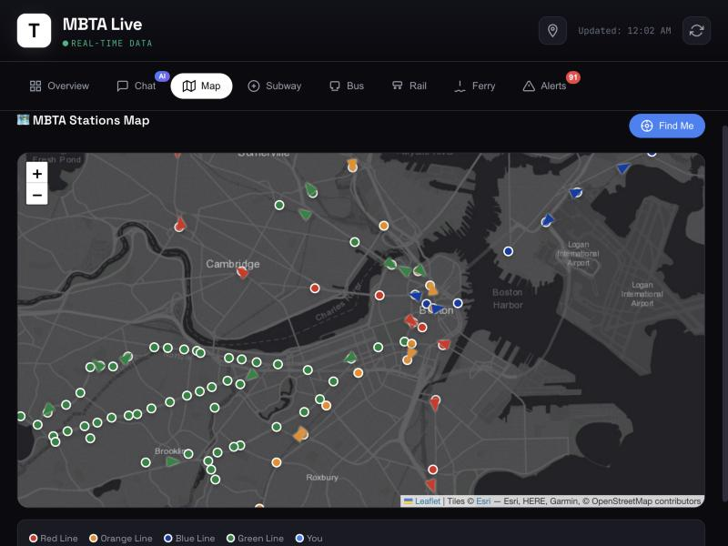
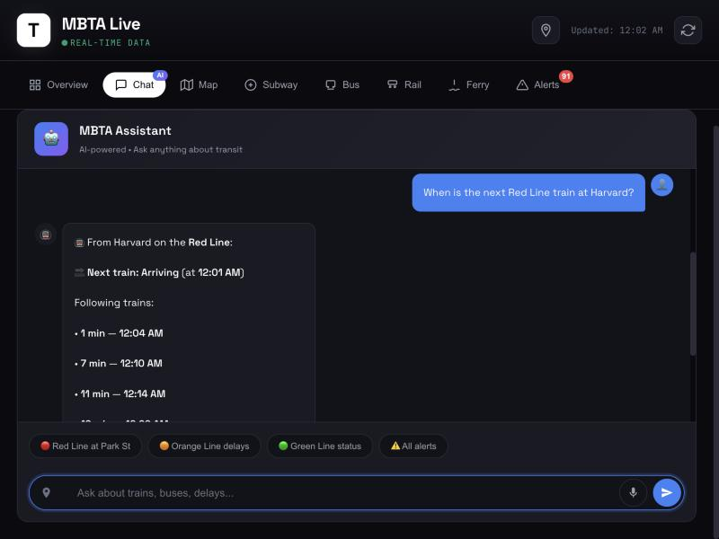
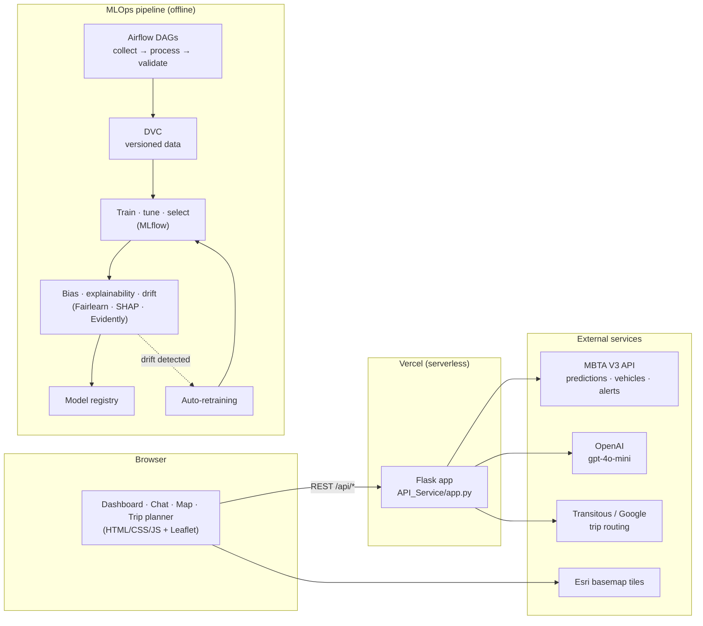

<div align="center">

# 🚇 Charlie

### An AI-powered real-time transit assistant for Boston's MBTA

Live arrivals, service alerts, a live train map, multi-modal trip planning, and a chatbot you can just ask —
backed by an end-to-end MLOps pipeline for train-delay prediction.

[](https://charlie-mbta.vercel.app)




</div>

---

## Table of contents

- [Features](#-features)
- [Screenshots](#-screenshots)
- [Architecture](#-architecture)
- [Repository structure](#-repository-structure)
- [Run it locally](#-run-it-locally)
- [Deployment](#-deployment)
- [API reference](#-api-reference)
- [MLOps pipeline](#-mlops-pipeline)
- [Tech stack](#-tech-stack)
- [Acknowledgements](#-acknowledgements)

---

## ✨ Features

| | Feature | What it does |
|---|---|---|
| 🤖 | **AI chatbot** | Ask in plain English — *"When's the next Red Line train at Harvard?"* — and get live answers. Understands follow-ups and your current location. Voice input and spoken replies via the Web Speech API. |
| 🗺️ | **Trip planner** | Door-to-door transit directions across subway, bus, commuter rail and ferry, with transfers, walking time and fares. Uses Google Directions when a key is set, and the free [Transitous](https://transitous.org) router otherwise. |
| 📍 | **Live train map** | Every subway and Green Line train on a dark map, color-coded by line and pointing in its direction of travel, refreshed every 10 seconds. |
| ⏱️ | **Real-time arrivals** | Search any of 126 stations and see upcoming arrivals, sorted by time. |
| 🚨 | **Service alerts** | Line-by-line system status and active MBTA alerts at a glance. |
| 🚌 | **All modes** | Dedicated tabs for subway, bus, commuter rail and ferry. |
| 📡 | **Location aware** | "Find me" detects your nearest station; the chatbot and trip planner use it automatically. Location stays in your browser. |

---

## 📸 Screenshots

<table>
  <tr>
    <td width="50%"><p align="center"><b>Trip planner</b> — Fenway → Logan Airport</p></td>
    <td width="50%"><p align="center"><b>Live map</b> — trains update every 10 s</p></td>
  </tr>
  <tr>
    <td width="50%"><p align="center"><b>AI chatbot</b> — live arrivals in plain English</p></td>
    <td width="50%"><p align="center"><b>Dashboard</b> — system status and alerts</p></td>
  </tr>
</table>

---

## 🧩 Architecture



**How a request flows:** the browser calls the Flask API, which fetches live data from the MBTA V3 API and returns it as JSON. For chat, a first OpenAI call works out what the user wants (station, line, direction, trip). The app then pulls the matching live MBTA data, and a second call turns it into a friendly reply. Chat history and location live in the user's browser and are sent with each request, so the serverless backend stays stateless.

---

## 📁 Repository structure

```
Charlie/
├── API_Service/              ← The live web app (deployed to Vercel)
│   ├── app.py                ← Flask app: REST API, chatbot, trip planner
│   ├── templates/index.html  ← Single-page dashboard
│   ├── static/               ← script.js, style.css
│   ├── api/                  ← MBTA client, stop finder, helpers
│   ├── data/stops.json
│   ├── requirements.txt
│   └── Dockerfile            ← Container build (legacy Cloud Run deploy)
│
├── Data_Pipeline/            ← Airflow DAGs + scripts: fetch, preprocess, validate, bias
├── Model_Development/        ← Training, tuning, selection, explainability, drift
│   ├── ml_src/               ← Pipeline modules (python -m Model_Development.ml_src.*)
│   ├── models/               ← Trained model artifacts + metadata
│   └── reports/              ← Bias, SHAP, LIME, drift and comparison reports
├── monitoring/               ← Model + drift monitors, Prometheus exporter
├── retraining/               ← Drift-triggered retraining with notifications
├── frontend-react/           ← Experimental Next.js live-map frontend
├── .github/workflows/        ← CI/CD (model pipeline; manual Cloud Run deploys)
├── dvc.yaml · dvc.lock       ← Data pipeline stages
└── docker-compose.yaml       ← Local Airflow stack
```

---

## 🚀 Run it locally

**Prerequisites:** Python 3.11+, a free [MBTA V3 API key](https://api-v3.mbta.com/), and an [OpenAI API key](https://platform.openai.com/api-keys) for the chatbot.

```bash
git clone https://github.com/Gnanasudharsan/Charlie.git
cd Charlie/API_Service

python -m venv .venv
source .venv/bin/activate          # Windows: .venv\Scripts\activate
pip install -r requirements.txt
```

Create `API_Service/.env`:

```env
MBTA_API_KEY=your_mbta_key
OPENAI_API_KEY=your_openai_key
# Optional — trip planner falls back to Transitous without it
GOOGLE_MAPS_API_KEY=your_google_maps_key
```

Start the app:

```bash
python app.py
```

Open **http://localhost:5001**.

### Environment variables

| Variable | Required | Used for |
|---|---|---|
| `MBTA_API_KEY` | Recommended | Live predictions, vehicles and alerts. Works without it, but at a much lower rate limit. |
| `OPENAI_API_KEY` | For chat | AI chatbot. Without it, chat runs in a basic fallback mode. |
| `GOOGLE_MAPS_API_KEY` | Optional | Google transit directions. Without it, the trip planner uses Transitous (free, no key). |

---

## 🌐 Deployment

The app runs on **[Vercel](https://vercel.com)** as a serverless Python function: **https://charlie-mbta.vercel.app**

- **Automatic deploys:** every push to `main` deploys to production. The Vercel project is connected to this repo with **Root Directory** set to `API_Service`.
- **Secrets:** `MBTA_API_KEY` and `OPENAI_API_KEY` (and optionally `GOOGLE_MAPS_API_KEY`) are set as Vercel environment variables. Nothing secret is stored in the repo.
- **Zero config:** Vercel detects the Flask `app` in `app.py`, so no `vercel.json` is needed.

To deploy your own copy:

```bash
npm i -g vercel
vercel link                      # from the repo root; set Root Directory to API_Service
vercel env add MBTA_API_KEY --environment production
vercel env add OPENAI_API_KEY --environment production
vercel deploy --prod
```

<details>
<summary><b>Legacy: Google Cloud Run</b></summary>

The project was originally deployed to Google Cloud Run via Docker and GitHub Actions (`.github/workflows/deploy.yml`, `deploy-cloudrun.yml`). Those workflows now run only on manual dispatch. To use them, enable billing on the GCP project and set the `GCP_SA_KEY`, `MBTA_API_KEY` and `OPENAI_API_KEY` repository secrets.

```bash
cd API_Service
docker build --platform linux/amd64 -t gcr.io/<PROJECT>/charlie-mbta-api .
docker push gcr.io/<PROJECT>/charlie-mbta-api
gcloud run deploy charlie-mbta-api --image gcr.io/<PROJECT>/charlie-mbta-api \
  --region us-east1 --allow-unauthenticated
```

</details>

---

## 📡 API reference

All endpoints return JSON. Base URL: `https://charlie-mbta.vercel.app`

| Method | Endpoint | Description |
|---|---|---|
| `GET` | `/health` | Service health and version |
| `POST` | `/api/chat` | Chat with the assistant. Body: `{ "message", "history"?, "location"? }` |
| `POST` | `/api/trip-planner` | Transit directions. Body: `{ "origin", "destination", "origin_coords"?, "dest_coords"? }` |
| `GET` | `/api/dashboard` | Line-by-line status and severe alerts |
| `GET` | `/api/predictions?stop=<id>` | Upcoming arrivals at a stop (or `?route=<id>`) |
| `GET` | `/api/station/<stop_id>` | Station details and arrivals, sorted by time |
| `GET` | `/api/vehicles?route=<ids>` | Live vehicle positions (comma-separated route IDs) |
| `GET` | `/api/alerts` | Active service alerts |
| `GET` | `/api/routes` | Routes by mode |
| `GET` | `/api/line/<line_id>` | Status, vehicles and alerts for one line |
| `GET` | `/api/stations` | All stations with coordinates and lines |
| `GET` | `/api/nearest-station?lat=&lon=` | Nearest station to a coordinate |
| `POST` | `/api/set-location` | Resolve a coordinate to its nearest station |

<details>
<summary><b>Examples</b></summary>

```bash
# Next trains at Park Street
curl "https://charlie-mbta.vercel.app/api/predictions?stop=place-pktrm"

# Ask the assistant
curl -X POST https://charlie-mbta.vercel.app/api/chat \
  -H "Content-Type: application/json" \
  -d '{"message": "When is the next Red Line train at Harvard?"}'

# Plan a trip
curl -X POST https://charlie-mbta.vercel.app/api/trip-planner \
  -H "Content-Type: application/json" \
  -d '{"origin": "Fenway Park", "destination": "Logan Airport"}'
```

</details>

---

## 🧠 MLOps pipeline

Alongside the live app, Charlie includes a full MLOps pipeline that predicts **train-delay probability** from MBTA event data.

### 1 · Data pipeline — [`Data_Pipeline/`](Data_Pipeline/readme.md)

Apache Airflow orchestrates four DAGs, and DVC versions every dataset:

| DAG | Purpose |
|---|---|
| `data_collection_dag` | Fetch routes, vehicles and alerts from the MBTA API |
| `data_processing_dag` | Clean raw JSON into structured CSVs |
| `data_quality_dag` | Schema validation (TFDV / Great Expectations), anomaly detection, alerting |
| `mbta_pipeline_dvc` | End-to-end run with DVC tracking |

Bias in the data is checked with **Fairlearn** before training.

### 2 · Model development — [`Model_Development/`](Model_Development/readme.md)

- Baseline **Logistic Regression** and **LightGBM**, with hyperparameter tuning (GridSearch + SMOTE for class imbalance)
- Automatic **best-model selection** by ROC-AUC, tracked in **MLflow**
- **Explainability** with SHAP and LIME, plus **fairness** evaluation by direction
- **Drift monitoring** with Evidently against reference statistics

| Model | ROC-AUC |
|---|---|
| Logistic Regression (tuned) ✅ selected | **0.81** |
| LightGBM (baseline) | 0.68 |

<sub>From `Model_Development/reports/model_comparison.json`. Reports and plots live in `Model_Development/reports/`.</sub>

### 3 · Monitoring & retraining — [`monitoring/`](monitoring/README.md) · [`retraining/`](retraining/)

Drift and model-performance monitors export Prometheus-compatible metrics. When feature drift (PSI) passes the threshold, `retraining/trigger_retrain.py` retrains the model, promotes it only if its AUC beats the current model's, and sends a notification.

### 4 · CI/CD — [`.github/workflows/`](.github/workflows/)

`charlie_mbta_ci.yml` runs on every push and pull request. It pulls DVC data, then trains, tunes, selects, registers, runs bias, explainability and drift checks, and uploads the reports as build artifacts.

```bash
# Run pipeline stages locally (from the repo root)
pip install -r requirements.txt
python -m Model_Development.ml_src.model_train
python -m Model_Development.ml_src.model_tuning
python -m Model_Development.ml_src.model_select
python -m Model_Development.ml_src.monitor_drift
```

---

## 🧰 Tech stack

| Area | Tools |
|---|---|
| **Web app** | Flask, Gunicorn, vanilla JS, Leaflet, Web Speech API |
| **AI** | OpenAI GPT-4o-mini (intent detection + response generation) |
| **Data sources** | MBTA V3 API, Transitous (MOTIS), Google Directions (optional), Esri basemaps |
| **Hosting** | Vercel (serverless, auto-deploy from GitHub) |
| **Data pipeline** | Apache Airflow, DVC, Great Expectations, TFDV, pandas |
| **ML** | scikit-learn, LightGBM, imbalanced-learn (SMOTE), MLflow |
| **Responsible AI** | Fairlearn, SHAP, LIME, Evidently |
| **Ops** | GitHub Actions, Docker, Prometheus metrics |

---

## 🙏 Acknowledgements

- Transit data from the [MBTA V3 API](https://www.mbta.com/developers/v3-api)
- Trip routing by [Transitous](https://transitous.org), built on [MOTIS](https://github.com/motis-project/motis) and open GTFS data
- Map tiles © [Esri](https://www.esri.com) and © OpenStreetMap contributors
- Built for **IE 7374 — MLOps** at Northeastern University (Group 22)

## 📄 License

Released under the [MIT License](LICENSE).
